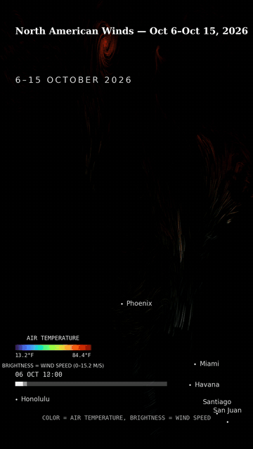

# EarthWatch-Suite

[](https://github.com/crieck2010/earthwatch-suite/actions/workflows/ci.yml)




**EarthWatch-Suite** is the unified monorepo consolidating 28 specialized geospatial remote-sensing, hydrodynamic particle flow, and vertical map reel engines. It transforms free satellite imagery (Sentinel-2, Landsat via STAC) and operational hydrodynamic/climatological data (NOAA OFS, Copernicus Marine, GLSEA) into actionable monitoring intelligence and automated, high-impact vertical video reels.

The terrestrial surveying counterpart (COGO, level networks, least-squares 3D adjustments, geodesy, and point clouds) lives in the flagship companion project **[crieck2010/survey-suite](https://github.com/crieck2010/survey-suite)**.

---

## Architecture Overview

```
                               ┌─────────────────────────────────────────────────────────┐
                               │                 EARTHWATCH-SUITE                        │
                               └────────────────────────────┬────────────────────────────┘
                                                            │
                 ┌──────────────────────────────────────────┴──────────────────────────────────────────┐
                 │                                                                                     │
                 ▼                                                                                     ▼
  ┌─────────────────────────────┐                                                       ┌─────────────────────────────┐
  │   Remote Sensing Analytics  │                                                       │ Physical Flow & Video Reels │
  ├─────────────────────────────┤                                                       ├─────────────────────────────┤
  │ imagery   • STAC ingestion  │                                                       │ currents  • NOAA OFS / GLSEA│
  │ change    • Difference / DoD│                                                       │ flow      • Particle advect │
  │ monitor   • Scheduled alert │                                                       │ viz       • Cartography spec│
  │ alerts    • PDF / Email     │                                                       │ animate   • Frame sequencing│
  │ vegetation• NDVI/EVI pheno  │                                                       │ reels     • Video production│
  │ flood     • NDWI water masks│                                                       │ aesthetics• Glow / presets  │
  │ burn      • NBR fire scars  │                                                       │ layout    • Multi-platform  │
  │ coast     • Shoreline drift │                                                       │ gazetteer • Place geocoding │
  │ thermal   • LST / Heat island│                                                      │ studio    • Streamlit GUI   │
  │ elev3d    • DSM cut/fill vol│                                                       │ narrate   • Story generator │
  └──────────────┬──────────────┘                                                       └──────────────┬──────────────┘
                 │                                                                                     │
                 └──────────────────────────────────────────┬──────────────────────────────────────────┘
                                                            ▼
                                        ┌───────────────────────────────────────┐
                                        │ Standard Contracts & Cross-Interop    │
                                        │ • COG / GeoJSON / Zonal Stats CSV     │
                                        │ • Uniform site.yaml config schemas    │
                                        │ • Frame Manifests (survey-flow v1.0)  │
                                        └───────────────────────────────────────┘
```

---

## Consolidated Engine Catalog (28 Engines)

All 28 modular engines are co-located in `src/` and fully interoperable under a single install:

| Engine | Package Path | Primary CLI Command | Description |
|---|---|---|---|
| **imagery** | `src/imagery` | `survey-imagery` | STAC discovery, windowed AOI clipping, cloud masking, spectral indices |
| **change** | `src/change` | `survey-change` | Per-pass & per-pixel raster differencing, thresholding, and polygon vectorization |
| **monitor** | `src/monitor` | `survey-monitor` | Autonomous site-monitoring daemon, threshold evaluation, and alert dispatch |
| **alerts** | `src/alerts` | `survey-alerts` | Alert reporting pipeline with formatted email and PDF delivery |
| **licensekit** | `src/licensekit` | `survey-license` | Ed25519-signed cryptographically verified offline license gating |
| **vegetation** | `src/vegetation` | `survey-vegetation` | Phenology-aware NDVI, EVI, SAVI, GNDVI, and MSAVI anomaly detection |
| **flood** | `src/flood` | `survey-flood` | Automated NDWI water masks and per-pass flood extent differencing |
| **burn** | `src/burn` | `survey-burn` | NBR / dNBR fire scar mapping and severity classification |
| **coast** | `src/coast` | `survey-coast` | Shoreline position tracking, transect erosion rates, and storm impact deltas |
| **thermal** | `src/thermal` | `survey-thermal` | Landsat thermal calibration to LST, urban heat-island maps, heatwave tracking |
| **elev3d** | `src/elev3d` | `survey-3d` | Digital surface model (DSM/DEM) differencing and cut/fill volumetrics |
| **sites** | `src/sites` | `survey-sites` | Canonical `site.yaml` schema validator and multi-biome reference pack |
| **currents** | `src/currents` | `survey-currents` | NOAA OFS, CMEMS, and GLSEA sea surface temperature & vector field ingestion |
| **flow** | `src/flow` | `survey-flow` | 2D/3D particle advection, vector field rendering, and frame manifest generation |
| **reels** | `src/reels` | `reels` | Automated vertical video reel generation pipeline with smart caching |
| **viz** | `src/viz` | `viz` | Declarative cartographic scene compiler (natural language to map render specs) |
| **animate** | `src/animate` | `survey-animate` | Video frame encoding, pan/zoom motion ramps, and overlays |
| **aesthetics**| `src/aesthetics`| *(library)* | Particle glow, line integral convolution (LIC), and cinematic palettes |
| **layout** | `src/layout` | *(library)* | Safe-zone framing for TikTok (9:16), Instagram Reels, and YouTube Shorts |
| **gazetteer** | `src/gazetteer` | *(library)* | Embedded geographic gazetteer and reverse geocoding bounding box resolver |
| **narrate** | `src/narrate` | *(library)* | Automated dynamic narrative beats, fact generation, and text formatting |
| **derive** | `src/derive` | *(library)* | Climatological baseline computations and standardized anomaly derivatives |
| **timescales**| `src/timescales`| `survey-timescales` | Temporal scale detection, stride adjustment, and framing optimization |
| **autopilot** | `src/autopilot` | *(library)* | Heuristic salience scoring, density optimization, and QA composition |
| **schedx** | `src/schedx` | *(library)* | Automated reel scheduling, cadence management, and batch execution |
| **style** | `src/style` | *(library)* | Visual styling presets, typography palettes, and watermark management |
| **trends** | `src/trends` | `survey-trends` | Trend radar, viral topic extraction, and social signal integration |
| **studio** | `src/studio` | *(streamlit)* | Interactive Streamlit web workstation for reel curation and live preview |

---

## Installation

### Core Installation (Headless Remote Sensing & Reel Engines)

```bash
pip install -e .
```

*Includes all 28 engines with lightweight dependencies (`numpy`, `scipy`, `pillow`, `matplotlib`, `pyyaml`, `requests`).*

### With Interactive Reel Studio

```bash
pip install -e ".[studio]"
```

*Adds `streamlit` to launch the interactive Reel Studio workstation.*

### With Direct GDAL / GeoTIFF Writing

```bash
pip install -e ".[gis]"
```

*Adds `rasterio` for native Cloud-Optimized GeoTIFF raster creation.*

---

## Quickstart

### 1. Ingest Satellite Imagery & Detect Change

```bash
# Discover and acquire Sentinel-2 bands over an AOI
survey-imagery acquire --aoi site_boundary.geojson --collection sentinel-2-l2a --out-dir ./imagery/

# Compute automated NDVI vegetation change between two passes
survey-change detect ./imagery/pass1_ndvi.tif ./imagery/pass2_ndvi.tif --out-dir ./change/ --threshold 0.15
```

### 2. Generate Hydrodynamic Flow Field Reel

```bash
# Ingest NOAA Great Lakes / Ocean current vector field
survey-currents fetch-glsea-sst --date 2026-09-15 --out sst.nc

# Advect particle flow and render frame manifest
survey-flow render --field-source noaa-ofs/LMHOFS --style reel-dark --out-dir ./flow_frames/

# Encode final 9:16 vertical video reel
survey-animate encode ./flow_frames/manifest.json --fps 30 --out currents_reel.mp4
```

### 3. Launch Interactive Studio

```bash
streamlit run app.py
```

---

## Testing & Quality Assurance

EarthWatch-Suite adheres to rigorous test standards. The complete test suite contains **3,360+ tests** executed across Python 3.10 through 3.13 on both Linux and Windows:

```bash
# Run the entire test suite
pytest -v

# Run with coverage report
pytest --cov=src --cov-report=term-missing
```

---

## License

Distributed under the [MIT License](LICENSE).
